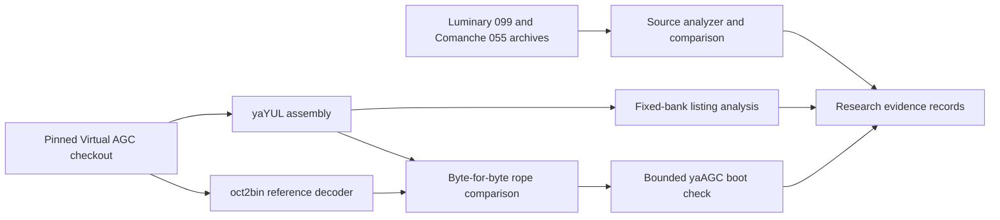

# APOLLO-11 REENGINEERED

**Reproducible flight-software research for the Apollo Guidance Computer Block II**

Apollo 11 used a Block II Apollo Guidance Computer (AGC) in each of its two
crewed modules. This project preserves the yaYUL-format transcriptions of
**Luminary 099/1**, the Lunar Module program, and **Comanche 055** (Colossus
2A), the Command Module program. It builds host tools to reproduce, inspect
and compare these programs while retaining the original assembly and
hardware model. [Historical sources and attribution](docs/HISTORICAL_SOURCES.md).

## Current capabilities

| Capability | Status |
| --- | --- |
| Historical archive | 177 source and index files verified against the pinned transcription |
| Source statistics and comparison | Text and JSON reports for a supported subset of Block II yaYUL source |
| Fixed-memory analysis | Bank occupation, checksums and unlisted ranges from completed AGC4 listings |
| Optimization reports | A versioned evidence template and validator |
| Luminary 099/1 reproduction | The pinned Virtual AGC build matched the proofed reference byte for byte |
| Emulator smoke test | The verified Luminary rope met a deterministic yaAGC boot checkpoint |

The archived Luminary transcription has two missing include names. A staged
alias-only build differs from the proofed rope in four encoded words.
Correcting the layout of two relative labels in the staged copy produces a
byte-identical rope while preserving the archive as supplied.
[Historical build results](docs/HISTORICAL_BUILD.md).
[Archive reproduction experiment](experiments/archive-include-aliases.md).

## AGC Block II

| Property | Specification |
| --- | --- |
| Fixed core rope | 36,864 words in 36 banks |
| Erasable magnetic core | 2,048 words in eight banks |
| Stored word | 15 information bits and one odd parity bit |
| Addressing | 12-bit CPU addresses with switched banks and fixed-fixed regions |
| Arithmetic | One's complement, including positive and negative zero |
| Memory cycle | Approximately 11.7 microseconds |

The AGC uses priority interrupts and a software interpreter alongside its
native instruction set. Bank selection, overflow, editing registers and
interrupt timing can affect the behavior of a change. Read the
[hardware constraints](docs/AGC_CONSTRAINTS.md) for the memory map and sources.

## Architecture



| Path | Contents |
| --- | --- |
| [Luminary099/](Luminary099/) and [Comanche055/](Comanche055/) | Historical transcriptions and source indexes |
| [tools/apollo_agc/](tools/apollo_agc/) | Python CLI and analysis modules |
| [scripts/](scripts/) | Virtual AGC setup, rope verification and emulator harness |
| [tests/](tests/) | Automated tests and representative inputs |
| [optimizations/](optimizations/) | Evidence record template |
| [experiments/](experiments/) | Reproducible experiments and observed results |
| [docs/](docs/) | Architecture, tooling, testing and historical provenance |
| [.github/](.github/) | CI workflows and issue templates |

## Install and use

Requires Python 3.11 or newer and Git. Clone the repository, then install the
CLI in an activated virtual environment.

```sh
git clone https://github.com/ImRafo/Apollo-11-Reengineered.git
cd Apollo-11-Reengineered
python -m pip install -e .
apollo-agc analyze Luminary099 --format json
apollo-agc compare Luminary099/EXECUTIVE.agc Comanche055/EXECUTIVE.agc
apollo-agc optimization optimizations/proposal.template.json
```

See the [development setup](docs/DEVELOPMENT_SETUP.md) for environment
activation and the [tool guide](docs/TOOLING.md) for reporting details.

## Build and verify Luminary 099

```sh
python -m pip install ziglang==0.15.2
python scripts/virtualagc.py
python scripts/reproduce_luminary.py
apollo-agc memory build/luminary099/assembly.lst
python scripts/emulator_smoke.py build/luminary099/Luminary099.bin
```

The [historical build guide](docs/HISTORICAL_BUILD.md) records the pinned
revision, reference digest, supported compiler invocation and measured
outcomes.

## Test and contribute

```sh
python -m pip install -r requirements-dev.txt
python -m compileall -q tools scripts tests
python -m unittest discover -s tests -v
python -m ruff check tools scripts tests
python -m ruff format --check tools scripts tests
python -m build
python -m twine check --strict dist/*
```

Proposed assembly changes need an assembled baseline, a documented hardware
state, per-path cycle measurements where available, and equivalence and emulator
evidence. The [methodology](docs/OPTIMIZATION_METHODOLOGY.md) describes how
to collect those results. See the [roadmap](ROADMAP.md) and
[contributing guide](CONTRIBUTING.md) for milestone and review criteria.

## Credits and licensing

Credit for the historical software belongs to the Apollo software teams at
the MIT Instrumentation Laboratory. The MIT Museum, Deborah Douglas, Paul
Fjeld, Ron Burkey, the Virtual AGC contributors and the Apollo-11 GitHub mirror
made the preserved transcriptions accessible.
[Historical credits](docs/HISTORICAL_SOURCES.md).

Original project contributions use [Apache-2.0](LICENSE). The historical
transcriptions retain the upstream
[Public Domain Mark notice](LICENSES/Apollo-11-PDM.md). Virtual AGC host tools
are obtained separately under their upstream terms.

This is an independent research project. It has no NASA affiliation or
endorsement and carries no flight certification.
